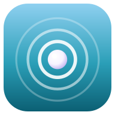

  

<h1 align="center">Tidepool</h1>

  A calm idle game about growing a tide pool, from a single polyp to a leviathan-filled deep.

  <a href="https://zhandermusic.github.io/tidepool/"><b>▶ Play now</b></a> ·
  <a href="https://github.com/ZhanderMusic/tidepool/releases/latest">Download for Windows</a>

---

## Now playing

**Halloween event, until November 1.** Four limited exotic skins in the Halloween shop: Haunted harbor, Jack-o'-lantern, Spooky spirits, and the Lantern phantom companion.

**Season 1: Brinelight, until November 21.** Climb 100 pass tiers of skins and shells.

## How to play

1. **Tap the water** to gather plankton.
2. **Grow your reef.** Spend plankton on polyps, sponges, anemones, kelp beds and deeper creatures that gather plankton for you, even while you're away.
3. **Catch blooms.** Glowing blooms drift by now and then. Tap them for a Frenzy or Surge boost.
4. **Spawn** when growth slows down. Your reef starts over, but you earn **pearls** for permanent upgrades that make every run faster.
5. **Ascend** to reach new ranks, from Tidewatcher to Tide Sovereign. Each one unlocks deeper reefs and new tides.

## Features

- **Dozens of reef creatures** across ten ascensions, each deeper than the last
- **Pearl and shell upgrades** that carry over between runs
- **Season pass** with 100 tiers of rewards
- **Missions and a daily catch** for extra shells and XP
- **Trophies** for milestones big and small
- **Skins** for the water, reef colors, tap effect and a companion, from common to exotic
- **Offline progress**, so your pool keeps growing while you're away
- **Save codes** to back up your progress or move it to another device
- **Light and dark mode**, and it plays offline once loaded

## Install it

Tidepool runs in your browser, and you can install it like an app:

- **iPhone / iPad:** open the [game link](https://zhandermusic.github.io/tidepool/) in Safari, then tap **Share → Add to Home Screen**.
- **Android:** open the link in Chrome and tap **Install** (or **⋮ → Add to Home screen**).
- **Windows:** download the setup file from the [latest release](https://github.com/ZhanderMusic/tidepool/releases/latest). If Windows shows "Windows protected your PC," click **More info → Run anyway**.

The phone and web versions update automatically. The Windows app tells you when a new version is out.

> **Tip:** Your progress is saved on your device. Copy a save code now and then (Trophies tab → Save data) so you never lose it.
